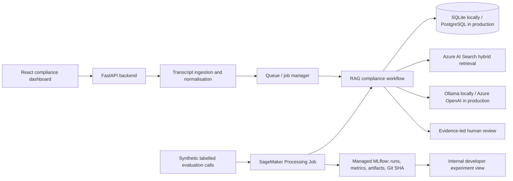

# ClearCall - AI-powered compliance review assistant

This folder contains the requested architecture: a web dashboard, FastAPI
ingestion/job/RAG backend, Azure-ready retrieval and generation provider seams,
and a SageMaker-ready offline evaluation layer. The repository deliberately uses
only synthetic data.



## What is included

- `backend/data/synthetic_conversations.json`: ten 3-minute synthetic,
  timestamped employee-customer conversations with evaluation labels.
- `backend/app`: FastAPI APIs, transcript ingestion, local job persistence,
  provider-configurable RAG workflow, and evidence-led checklist analysis.
- `backend/sagemaker`: Processing Job entry point for the evaluation workload.
- `react-frontend-staging`: existing Vite dashboard that can be connected to the
  API at `http://localhost:8000`.

## How the code works

For a checklist-analysis request, the backend follows this evidence-led flow:

```text
FastAPI request
  -> retrieve relevant transcript evidence
  -> relevance check
  -> prompt builder (evidence + question)
  -> answer generator
  -> verify the evidence quote
  -> Pass / Fail / Unclear JSON response
```

The FastAPI endpoint `POST /api/calls/{call_id}/analyse` is the primary local
test path. For each checklist question, the RAG workflow retrieves relevant
transcript chunks, asks the configured model to return a verdict, reason and
exact evidence quote, then accepts the result only when that quote is present
in the retrieved transcript evidence. Unsupported answers safely become
`Unclear`.

### Backend modules

- `backend/app/main.py` exposes REST endpoints for calls, analysis, transcript
  ingestion, background-job status, dashboard data and evaluation.
- `backend/app/rag.py` implements the retrieve -> relevance check -> augment ->
  generate workflow and validates evidence before returning a result.
- `backend/app/llm.py` uses local Ollama by default and provides an Azure OpenAI
  adapter for deployment.
- `backend/app/search.py` provides the Azure production retrieval path: Azure
  OpenAI embeddings plus Azure AI Search hybrid retrieval and semantic ranking.
- `backend/app/ingestion.py` normalises speaker-labelled, timestamped transcript
  utterances after speech-to-text processing.
- `backend/app/jobs.py` persists queued/running/completed transcript jobs in
  SQLite locally; production can replace this repository with PostgreSQL and a
  durable worker queue.
- `backend/app/evaluation.py` evaluates the synthetic dataset and records
  Recall@K, Precision@K, evidence support, verdict accuracy, macro F1, latency,
  estimated cost and Git commit ID.

### Local and cloud modes

Local development uses lexical retrieval, SQLite job storage and the Ollama
model installed on the developer machine. Set provider variables in
`backend/.env.example` to use Azure OpenAI and Azure AI Search in production.
SageMaker is reserved for reproducible offline evaluation and Managed MLflow
experiment logging; it is not required for local testing.

The evaluation labels are never sent to the model. They are used only after a
prediction is made, to score the system fairly.

### Current limitations

The local pipeline has been tested end-to-end, but local lexical retrieval can
occasionally return evidence relevant to a related checklist question rather
than the exact question. It also currently reports the beginning of the matched
chunk as the timestamp, rather than the exact utterance start time. Azure AI
Search semantic ranking and utterance-level timestamp matching are the intended
next improvements.

## Local run

Start the backend following [backend/README.md](backend/README.md), then run:

```powershell
cd react-frontend-staging
npm install
npm run dev
```

The full AWS resource creation is intentionally not automated because it needs
your AWS account, IAM permissions, region and budget controls. The included
Docker and Processing entry point are the deployment-ready hand-off.
