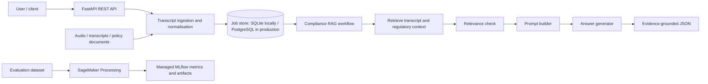

# ClearCall backend: local development and cloud RAG architecture

The backend implements the updated architecture with safe local development
defaults. It does not require Azure or AWS credentials to run against the
synthetic dataset.



## Local development flow

`POST /api/calls/{call_id}/analyse` follows the operational request path:

1. FastAPI accepts the checklist analysis request.
2. The workflow retrieves top-ranked transcript chunks. Local development uses
   lexical retrieval; production uses Azure AI Search hybrid retrieval.
3. It optionally obtains regulatory context, constructs an augmented prompt, and
   calls Ollama locally.
4. The relevance gate accepts an answer only when its exact evidence quote occurs
   in retrieved transcript text. Otherwise it returns `Unclear`.

The model never receives `expected_verdict`, labelled evidence, or labelled
reasons from the synthetic evaluation dataset.

## Run locally

Ollama must be running and have `llama3.1:8b` available.

```powershell
cd backend
python -m venv .venv
.\.venv\Scripts\Activate.ps1
python -m pip install -r requirements.txt
uvicorn app.main:app --reload
```

Use a second terminal to check configuration and run one call:

```powershell
Invoke-RestMethod http://localhost:8000/health
Invoke-RestMethod -Uri http://localhost:8000/api/calls/CC-3001/analyse -Method Post | ConvertTo-Json -Depth 10
```

The 8B Ollama model runs on the local CPU in this project, so a call containing
three checklist questions can take several minutes.

## Transcript ingestion and job manager

The local ingestion endpoint represents the output after Azure AI Speech has
transcribed audio. It stores an asynchronous job in `artifacts/clearcall_jobs.sqlite3`;
production should replace that repository with PostgreSQL and a durable worker
queue.

```powershell
$body = @{
  call_id = "UPLOAD-001"
  title = "Sample uploaded call"
  business_area = "Wealth advisory"
  risk_level = "medium"
  utterances = @(
    @{ start_seconds = 0; end_seconds = 8; speaker = "Advisor"; text = "The investment can fall in value." },
    @{ start_seconds = 9; end_seconds = 15; speaker = "Customer"; text = "I understand I could lose money." }
  )
  checklist = @(@{ id = "risk_ack"; question = "Did the customer acknowledge the risk disclosure?" })
} | ConvertTo-Json -Depth 6

Invoke-RestMethod -Uri http://localhost:8000/api/ingestions/transcripts -Method Post -ContentType application/json -Body $body
```

Poll the returned job ID:

```powershell
Invoke-RestMethod http://localhost:8000/api/jobs/job-REPLACE_ME | ConvertTo-Json -Depth 10
```

## Azure production path

Copy `.env.example` into your deployment configuration. Set:

```text
CLEARCALL_LLM_PROVIDER=azure_openai
CLEARCALL_RETRIEVAL_PROVIDER=azure_ai_search
```

Then provide Azure OpenAI and Azure AI Search endpoint, deployment/index, and
authentication settings. No secret is stored in this repository. The Azure AI
Search index needs `id`, `content`, `start_seconds`, `end_seconds`,
`source_type`, and `content_vector` fields. The application sends a semantic
hybrid request: BM25 text search plus an Azure OpenAI embedding-vector query
with semantic ranking.

Azure AI Speech is deliberately not called directly from this prototype because
audio storage, speech credentials, language selection, and speaker diarisation
need a deployment-specific security design. Its normalised transcript output is
the input to `/api/ingestions/transcripts`.

## SageMaker evaluation

`POST /api/evaluations/run` evaluates the labelled synthetic calls and records:

- Retrieval Recall@K and Precision@K
- Verdict accuracy and macro F1
- Evidence support rate, latency, local estimated cost, and Git commit ID

For the cloud path, build/push the Docker image, upload the evaluation data to
S3, then use `sagemaker/submit_processing_job.py`. By default its submission
sets Azure OpenAI and Azure AI Search as providers; inject Azure secrets through
your approved secret-management/deployment mechanism.
