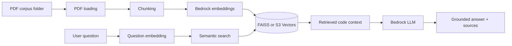

# LangChain Backend

This folder is a starter RAG backend for answering questions over a PDF corpus using AWS.

## What it does

- Loads PDFs from a dedicated corpus folder.
- Splits them into retrieval-sized chunks.
- Embeds the chunks with Amazon Bedrock embeddings.
- Stores the chunks in a local FAISS index by default.
- Can ingest and search the PDF corpus in S3 Vectors with `REGULATION_SEARCH_BACKEND=s3vectors`.
- See [S3 Vectors setup and testing](S3_VECTORS_TESTING.md) for the Docker handoff.
- Uses an Amazon Bedrock chat model to answer questions from retrieved context.

## How it maps to the AWS diagram



## Default AWS choices

- Model: `apac.amazon.nova-lite-v1:0`
- Embeddings: `cohere.embed-english-v3` (Titan is not offered in `ap-southeast-1`)
- Region: `ap-southeast-1`

This default pairing is configured for Singapore. The AWS account behind
`AWS_BEARER_TOKEN_BEDROCK` must be permitted to invoke Cohere Embed English in
`ap-southeast-1`. To use a different region or embedding model, set
`AWS_REGION` and `BEDROCK_EMBEDDING_MODEL` in `.env`.

## Endpoints

- `POST /ingest` builds or refreshes the local FAISS index.
- `POST /ingest?target=s3vectors` uploads corpus PDF chunks to S3 Vectors.
- Add `&dry_run=true` to preview S3 ingestion without embedding or uploading.
- `POST /ask` answers a question using retrieved code context.
- `POST /search` returns regulatory passages using the selected backend, without chat generation.
- `GET /health` returns a simple status payload.

## Corpus folder

Put your PDFs in [corpus/](corpus/) under this folder. The ingestion step reads every `*.pdf` file recursively from that directory.

## Local setup

1. Create a virtual environment.
2. Install dependencies from `requirements.txt`.
3. Set AWS credentials and region in your shell or `.env` file.
4. Run the app with `python -m langchain_backend.main`.

## S3 Vectors ingestion

Only PDFs inside the configured corpus folder (including nested folders) are
loaded. Checklist Python/JSON files, transcripts, and files outside the corpus
are not ingested. Linked files resolving outside the corpus are skipped.
The PDF text is split into 1,200-character chunks with 200-character overlap,
embedded with Bedrock, and uploaded with text, relative source filename,
zero-based page, embedding model, and corpus version metadata.

This is an explicit upload path. `/ask` and LangGraph guidance use the backend
selected by `REGULATION_SEARCH_BACKEND` (default `faiss`). S3 queries never
trigger automatic ingestion. See [setup and testing](S3_VECTORS_TESTING.md).

### Preview without an AWS bucket

From `langchain-backend`, using the environment where dependencies are installed:

```powershell
python -m langchain_backend.s3_ingestion --dry-run
```

This does not construct AWS clients or invoke Bedrock. The response reports
`pdf_files`, `documents` (PDF pages, preserving the existing API meaning),
`chunks`, `corpus_version`, and `vectors_uploaded: 0`. PDFs without extractable
text require OCR before they can contribute chunks.

### Create the AWS destination once

Use an AWS CLI/profile with credentials for your account. A Bedrock API key
(`AWS_BEARER_TOKEN_BEDROCK`) alone cannot authenticate S3 Vectors requests.
The following example creates a dedicated vector bucket and an index compatible
with the default `cohere.embed-english-v3` model. Substitute your own names:

```powershell
aws s3vectors create-vector-bucket --vector-bucket-name clearcall-mas-corpus --region ap-southeast-1
aws s3vectors create-index --vector-bucket-name clearcall-mas-corpus --index-name mas-cohere-v3 --data-type float32 --dimension 1024 --distance-metric cosine --metadata-configuration nonFilterableMetadataKeys=text --region ap-southeast-1
```

Add the destination to `langchain-backend/.env`:

```dotenv
AWS_REGION=ap-southeast-1
BEDROCK_EMBEDDING_MODEL=cohere.embed-english-v3
S3_VECTORS_BUCKET_NAME=clearcall-mas-corpus
S3_VECTORS_INDEX_NAME=mas-cohere-v3
```

Alternatively set `S3_VECTORS_INDEX_ARN` instead of the bucket/index pair; the ARN
takes precedence. Use an index in `AWS_REGION`. Provide standard AWS credentials
through an AWS profile, environment variables, or the application's IAM role.
The ingestion identity needs `s3vectors:GetIndex` and `s3vectors:PutVectors` on
the destination index, plus `bedrock:InvokeModel` for embeddings. Provisioning
also needs `s3vectors:CreateVectorBucket` and `s3vectors:CreateIndex`. If you use a
customer-managed KMS key, its policy and permissions must allow the operation.

### Upload

```powershell
python -m langchain_backend.s3_ingestion
```

Or, with the existing API running:

```powershell
Invoke-RestMethod -Method Post -Uri 'http://localhost:8001/ingest?target=s3vectors'
```

From Python, the existing service also supports
`RegulationSearch().ingest(target="s3vectors")`. The standalone command avoids
initializing the chat model and is recommended for ingestion jobs.

The writer verifies the index configuration before embedding and checks vector
dimensions before uploading each batch. It sends at most 64 vectors per request.
AWS errors propagate rather than reporting success. A failure can leave earlier
batches uploaded; rerunning an unchanged corpus reuses the same keys. It still
regenerates embeddings, so retrying incurs embedding charges.

Ingestion is versioned and does not delete old vectors. Revised PDFs produce a
new `corpus_version` and new keys. For a replacement corpus, use a fresh index,
or set `S3_VECTORS_CORPUS_VERSION` to the version returned by a **successful**
ingestion. S3 retrieval filters by this version and the configured embedding model.
Do not query an incomplete version after a failed run. Ingestion does not provision
resources or upload the original PDF binaries.

### Offline verification

```powershell
python -m unittest discover -s tests -v
```

Tests load real PDF fixtures and validate S3 request shapes using Botocore's
Stubber, with mocked embeddings. No AWS access or charges are required.
