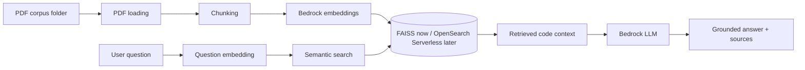

# LangChain Backend

This folder is a starter RAG backend for answering questions over a PDF corpus using AWS.

## What it does

- Loads PDFs from a dedicated corpus folder.
- Splits them into retrieval-sized chunks.
- Embeds the chunks with Amazon Bedrock embeddings.
- Stores the chunks in a local FAISS index by default.
- Uses an Amazon Bedrock chat model to answer questions from retrieved context.

## How it maps to the AWS diagram

## Default AWS choices

- Model: `apac.amazon.nova-lite-v1:0`
- Embeddings: `amazon.titan-embed-text-v2:0`
- Region: `ap-southeast-1`

## Endpoints

- `POST /ingest` builds or refreshes the index.
- `POST /ask` answers a question using retrieved code context.
- `GET /health` returns a simple status payload.

## Corpus folder

Put your PDFs in [corpus/](corpus/) under this folder. The ingestion step reads every `*.pdf` file recursively from that directory.

## Local setup

1. Create a virtual environment.
2. Install dependencies from `requirements.txt`.
3. Set AWS credentials and region in your shell or `.env` file.
4. Run the app with `python -m langchain_backend.main`.

## AWS upgrade path

The default index is local so you can start quickly. To move this to production on AWS, swap the vector store layer for OpenSearch Serverless or Kendra and keep the ingestion and prompting code the same.
